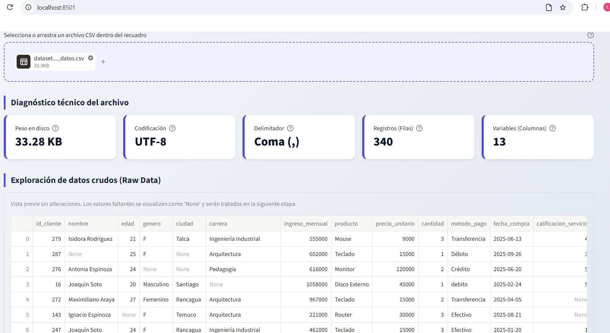
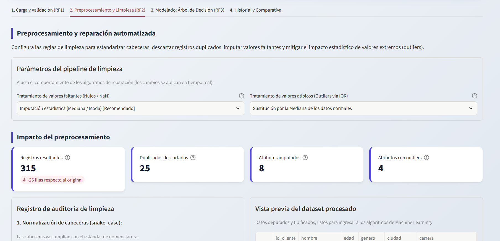

# Reporte de Validación y Pruebas (QA) — Entrega 1

**Responsable de Validación y UI/UX:** Erick Mamani  
**Responsable de Desarrollo Core y Arquitectura:** Franco Fajardo  
**Fecha de verificación:** 13 de noviembre de 2026  
**Dataset utilizado en pruebas:** `storage/datasets/datos_sucios_prueba.csv`

---

## 1. Carga y Limpieza Automática en Python (35% de la Nota 1)

### RF1: Carga y Validación de Datos (`analisis/validador.py`)
- [x] **Subida de archivo CSV:** Carga correcta mediante el selector interactivo en la Pestaña 1.
- [x] **Validación de formato y tamaño:** Bloqueo de archivos vacíos o mayores a 50 MB.
- [x] **Autodetección de codificación y separador:** Reconocimiento exitoso de codificación (`UTF-8` / `Latin-1`) y separador punto y coma (`;`).
- [x] **Vista previa:** Visualización de métricas de diagnóstico y tabla cruda original.
- **Resultado obtenido:** Archivo validado sin errores, detectando 6 columnas (5 predictoras/objetivo + ID) y mostrando las celdas vacías (`None`) previas al preprocesamiento.

### RF2: Limpieza Automática (`analisis/limpieza.py`)
- [x] **Normalización de columnas:** Conversión automática de cabeceras a formato `snake_case`.
- [x] **Eliminación de duplicados:** Descarte automático de registros repetidos.
- [x] **Corrección de tipos de datos:** Conversión de columnas numéricas almacenadas como texto.
- [x] **Tratamiento de valores nulos:** Prueba exitosa alternando entre imputación estadística (Mediana / Moda) y eliminación de filas.
- [x] **Manejo de Outliers (IQR):** Detección mediante Rango Intercuartílico ($Q1 - 1.5 \times IQR$ y $Q3 + 1.5 \times IQR$) probando Acotado (*Winsorizing*), Mediana y Eliminación.
- [x] **Resumen de transformaciones:** Tarjetas de impacto y registro de auditoría actualizados en tiempo real.

---

## 2. Módulo de Árbol de Decisión — Vista y Gestión (40% de la Nota 1)

### RF3: Entrenamiento, Visualización y Métricas (`analisis/arbol_decision.py`)
- [x] **Selección de variables:** Selección de variable objetivo (`abandono_cliente`) y filtrado automático de columnas `id` en las predictoras.
- [x] **Configuración de hiperparámetros:** Pruebas con criterios `gini` y `entropy`, profundidad máxima (`max_depth` de 1 a 10) y partición de prueba (`test_size`).
- [x] **Codificación categórica:** Transformación interna mediante *One-Hot Encoding* antes del ajuste en `scikit-learn`.
- [x] **Visualización del árbol:** Renderizado gráfico de nodos, reglas de decisión y clases.
- [x] **Cálculo de las 4 métricas exigidas:** Visualización de Exactitud (*Accuracy*), Precisión, Sensibilidad (*Recall*) y Matriz de Confusión interactiva en Plotly.

### RF3: Gestión y Comparación de Modelos (`web/app.py` y `storage/modelos/`)
- [x] **Guardar modelos:** Serialización del binario en `.pkl` y registro de metadatos en `registro_modelos.json`.
- [x] **Listar y comparar:** Tabla histórica y gráfico de barras agrupadas comparando `Arbol Gini Prof 3` vs `Arbol Entropia`.
- [x] **Eliminar modelos:** Borrado sincronizado del registro en la tabla y del archivo `.pkl` en disco.

---

## 3. Integración entre Capas, Git y Orden del Repositorio (25% de la Nota 1)

- [x] **Separación por capas:** Capa de lógica en `/analisis` desacoplada de la interfaz en `/web`.
- [x] **Dependencias y documentación:** Archivos `requirements.txt`, `.gitignore` y `README.md` operativos.
- [x] **Historial de Git:** Commits verificados de ambos integrantes en sus respectivas ramas e integrados en `develop` y `main`.