# Reporte de Validación y Pruebas (QA)

Este documento reúne la evidencia de pruebas del proyecto. Tiene dos tipos de evidencia:

1. **Pruebas automáticas** (`tests/`): 40 pruebas con `pytest` que verifican la capa de análisis. Se ejecutan con `python -m pytest -v`. Resultado detallado en [qa/resultados_pruebas.md](qa/resultados_pruebas.md).
2. **Pruebas manuales con capturas** de la aplicación funcionando. Cómo obtenerlas: [qa/GUIA_CAPTURAS.md](qa/GUIA_CAPTURAS.md).

---

# Entrega 1 — Avance (13 de noviembre)

**Responsable de Validación y UI/UX:** Erick Mamani  
**Responsable de Desarrollo Core y Arquitectura:** Franco Fajardo  
**Fecha de verificación:** 13 de noviembre de 2026  
**Dataset utilizado en pruebas:** `datos/ejemplos/00_mini_clientes.csv` (antes `storage/datasets/datos_sucios_prueba.csv`)

---

## 1. Carga y Limpieza Automática en Python (35% de la Nota 1)

### RF1: Carga y Validación de Datos (`analisis/validador.py`)
- [x] **Subida de archivo CSV:** Carga correcta mediante el selector interactivo en la Pestaña 1.
- [x] **Validación de formato y tamaño:** Bloqueo de archivos vacíos o mayores a 50 MB.
- [x] **Autodetección de codificación y separador:** Reconocimiento exitoso de codificación (`UTF-8` / `Latin-1`) y separador punto y coma (`;`).
- [x] **Vista previa:** Visualización de métricas de diagnóstico y tabla cruda original.
- **Resultado obtenido:** Archivo validado sin errores, detectando 6 columnas (5 predictoras/objetivo + ID) y mostrando las celdas vacías (`None`) previas al preprocesamiento.

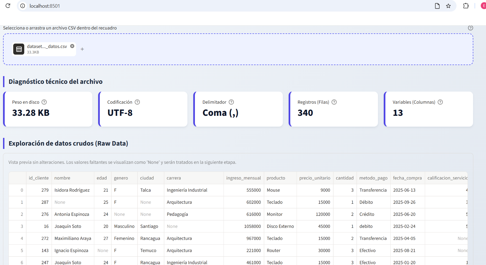

### RF2: Limpieza Automática (`analisis/limpieza.py`)
- [x] **Normalización de columnas:** Conversión automática de cabeceras a formato `snake_case`.
- [x] **Eliminación de duplicados:** Descarte automático de registros repetidos.
- [x] **Corrección de tipos de datos:** Conversión de columnas numéricas almacenadas como texto.
- [x] **Tratamiento de valores nulos:** Prueba exitosa alternando entre imputación estadística (Mediana / Moda) y eliminación de filas.
- [x] **Manejo de Outliers (IQR):** Detección mediante Rango Intercuartílico ($Q1 - 1.5 \times IQR$ y $Q3 + 1.5 \times IQR$) probando Acotado (*Winsorizing*), Mediana y Eliminación.
- [x] **Resumen de transformaciones:** Tarjetas de impacto y registro de auditoría actualizados en tiempo real.

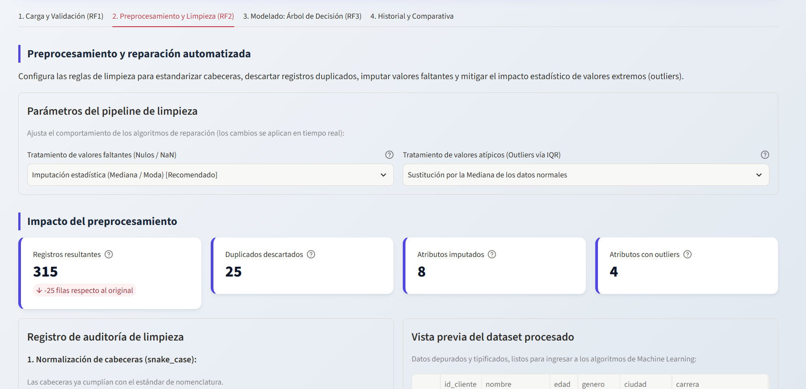
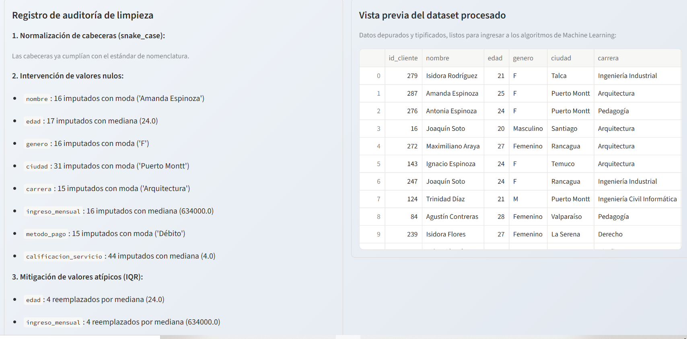

---

## 2. Módulo de Árbol de Decisión — Vista y Gestión (40% de la Nota 1)

### RF3: Entrenamiento, Visualización y Métricas (`analisis/arbol_decision.py`)
- [x] **Selección de variables:** Selección de variable objetivo (`abandono_cliente`) y filtrado automático de columnas `id` en las predictoras.
- [x] **Configuración de hiperparámetros:** Pruebas con criterios `gini` y `entropy`, profundidad máxima (`max_depth` de 1 a 10) y partición de prueba (`test_size`).
- [x] **Codificación categórica:** Transformación interna mediante *One-Hot Encoding* antes del ajuste en `scikit-learn`.
- [x] **Visualización del árbol:** Renderizado gráfico de nodos, reglas de decisión y clases.
- [x] **Cálculo de las 4 métricas exigidas:** Visualización de Exactitud (*Accuracy*), Precisión, Sensibilidad (*Recall*) y Matriz de Confusión interactiva en Plotly.

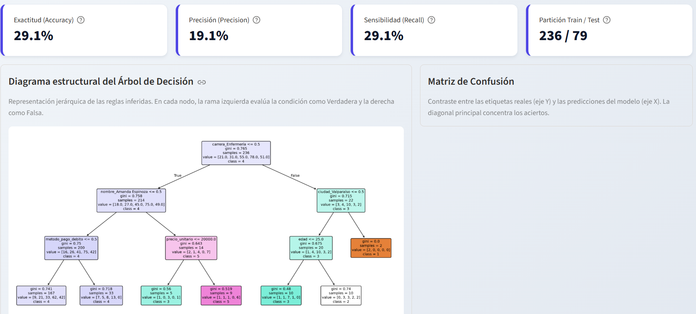
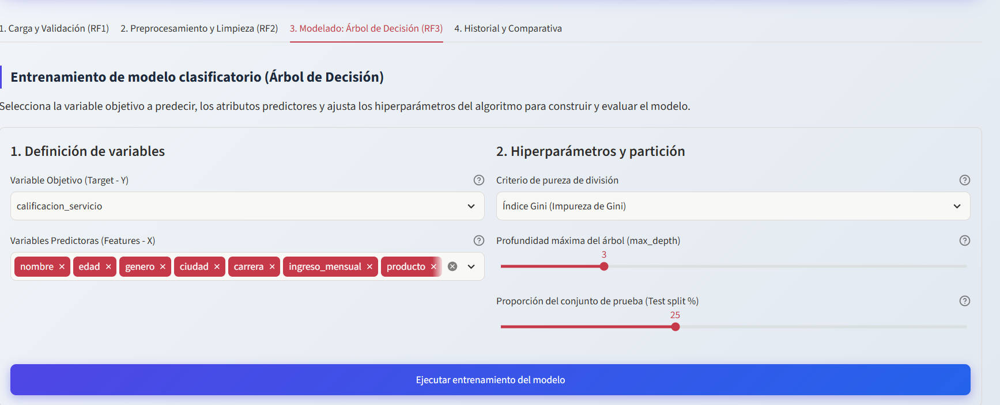

### RF3: Gestión y Comparación de Modelos (`web/vistas/historial.py` y `storage/modelos/`)
- [x] **Guardar modelos:** Serialización del binario en `.pkl` y registro de metadatos en `registro_modelos.json`.
- [x] **Listar y comparar:** Tabla histórica y gráfico de barras agrupadas comparando `Arbol Gini Prof 3` vs `Arbol Entropia`.
- [x] **Eliminar modelos:** Borrado sincronizado del registro en la tabla y del archivo `.pkl` en disco.

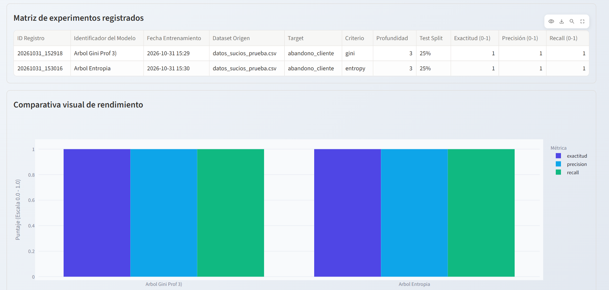

---

## 3. Integración entre Capas, Git y Orden del Repositorio (25% de la Nota 1)

- [x] **Separación por capas:** Capa de lógica en `/analisis` desacoplada de la interfaz en `/web`.
- [x] **Dependencias y documentación:** Archivos `requirements.txt`, `.gitignore` y `README.md` operativos.
- [x] **Historial de Git:** Commits verificados de ambos integrantes en sus respectivas ramas e integrados en `develop` y `main`.
---

# Entrega 2 — Entrega final (4 de diciembre)

**Datasets utilizados:** `datos/ejemplos/01_clientes_tienda.csv`, `02_estudiantes_notas.csv`, `03_compras_supermercado.csv`, `04_prestamos_banco.csv` y los archivos de `datos/pruebas_error/` (ver [datos/LEEME.md](../datos/LEEME.md)).

## Pruebas automáticas

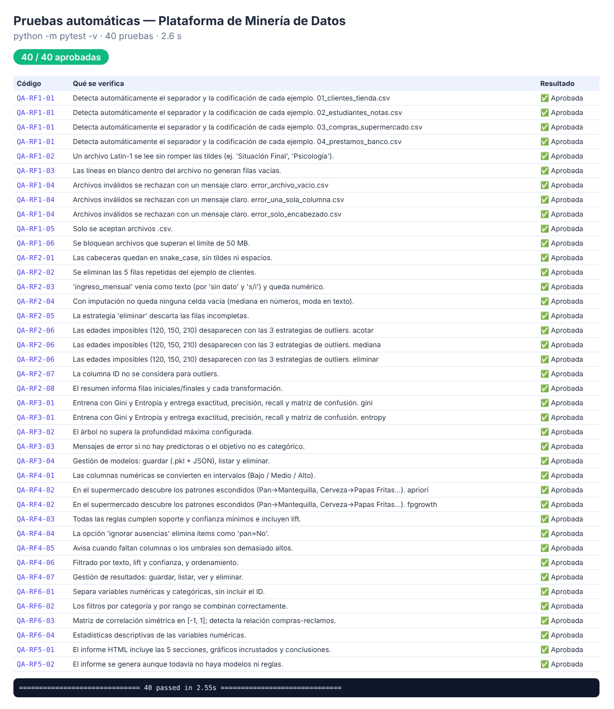

| Módulo | Archivo de pruebas | Pruebas | Resultado |
|---|---|---|---|
| RF1 Carga y validación | `tests/test_rf1_carga.py` | 11 | ✅ 11/11 |
| RF2 Limpieza automática | `tests/test_rf2_limpieza.py` | 10 | ✅ 10/10 |
| RF3 Árbol de decisión | `tests/test_rf3_arbol.py` | 5 | ✅ 5/5 |
| RF4 Reglas de asociación | `tests/test_rf4_asociacion.py` | 8 | ✅ 8/8 |
| RF5 Informe / RF6 Dashboard | `tests/test_rf5_rf6_informe_dashboard.py` | 6 | ✅ 6/6 |
| **Total** | | **40** | **✅ 40/40** |

## Pruebas manuales (aplicación web)

### RF1: Carga y validación
- [x] Carga de los 4 ejemplos con separadores distintos (`;`, `,`, `|`) y codificaciones UTF-8 / Latin-1 — *QA-RF1-01, QA-RF1-02*
- [x] Archivos inválidos rechazados con mensaje claro — *QA-RF1-04*
- [ ] Captura de la carga, de un archivo Latin-1 y de un error de validación

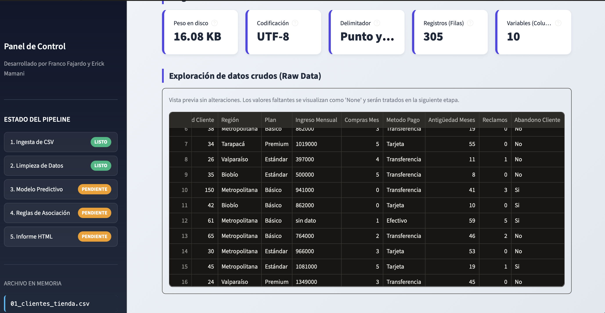

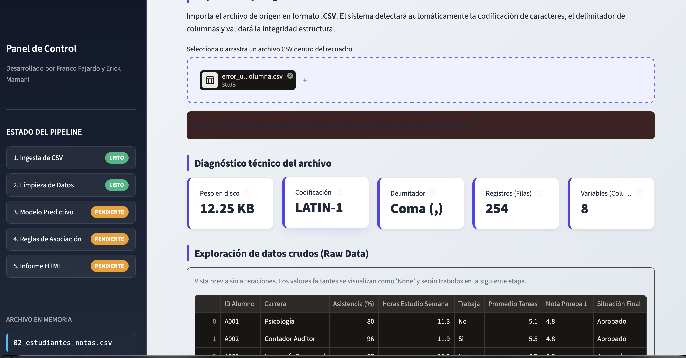

### RF2: Limpieza automática
- [x] Duplicados, tipos, nulos, outliers y nombres de columnas — *QA-RF2-01 a QA-RF2-08*
- [ ] Captura del resumen de limpieza y de la estrategia "eliminar"

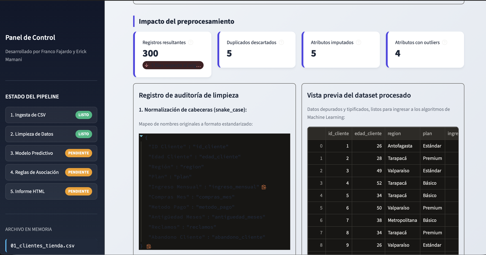
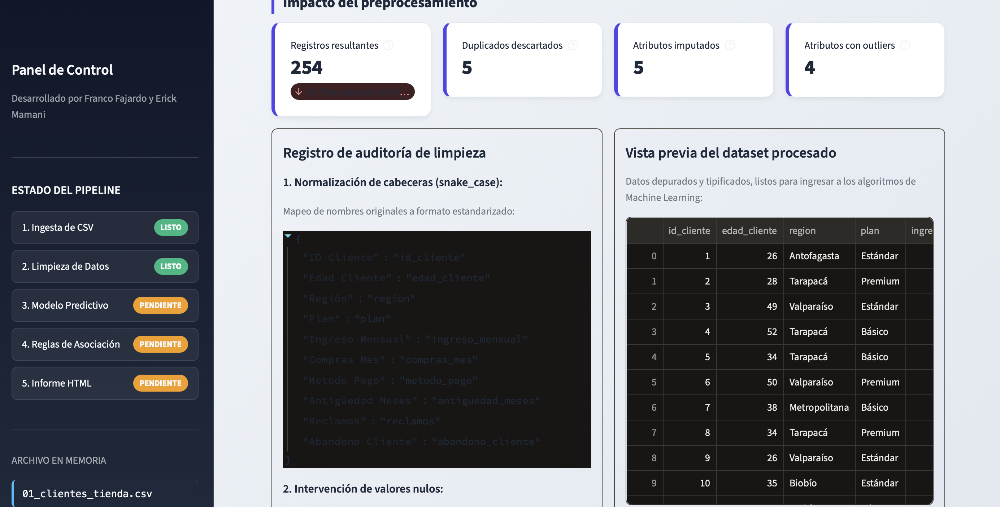

### RF3: Árbol de decisión y gestión de modelos
- [x] Entrenamiento Gini/Entropía, profundidad, métricas, guardar/listar/eliminar — *QA-RF3-01 a QA-RF3-04*
- [ ] Captura de métricas + árbol y del historial con 2 modelos

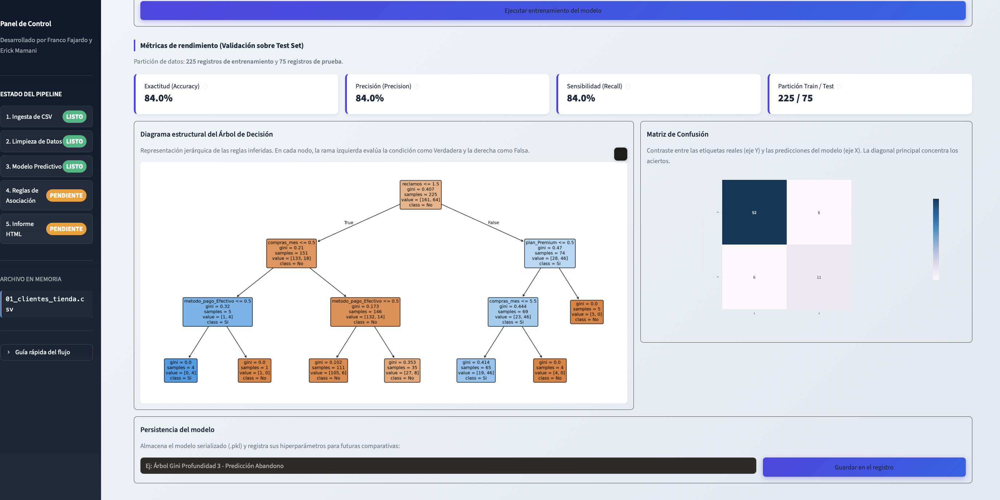
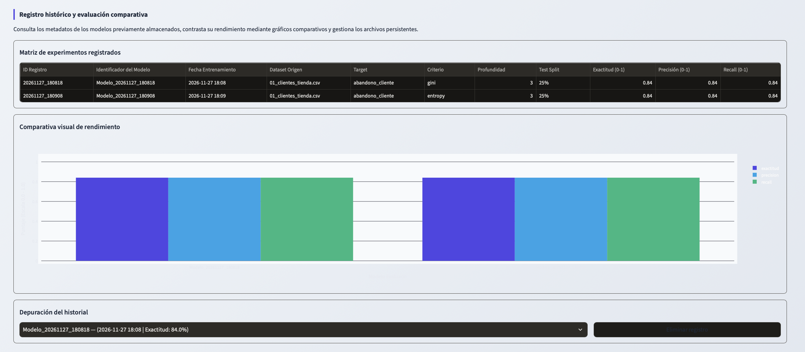

### RF4: Reglas de asociación (25% de la Nota 2)
- [x] Soporte y confianza mínimos configurables — *QA-RF4-03*
- [x] Generación con Apriori y FP-Growth — *QA-RF4-02*
- [x] Vista con soporte, confianza y lift — *QA-RF4-03*
- [x] Filtrado, ordenamiento y gestión de resultados guardados — *QA-RF4-06, QA-RF4-07*
- [ ] Capturas de configuración, filtrado y resultados guardados

### RF5: Informe (HTML obligatorio, PDF opcional)
- [x] Resumen de datos, limpieza, modelos, reglas y conclusiones — *QA-RF5-01, QA-RF5-02*
- [x] Exportación a HTML autocontenido
- [ ] PDF desde el navegador (Imprimir → Guardar como PDF)
- [ ] Captura de la pestaña Informe con la vista previa

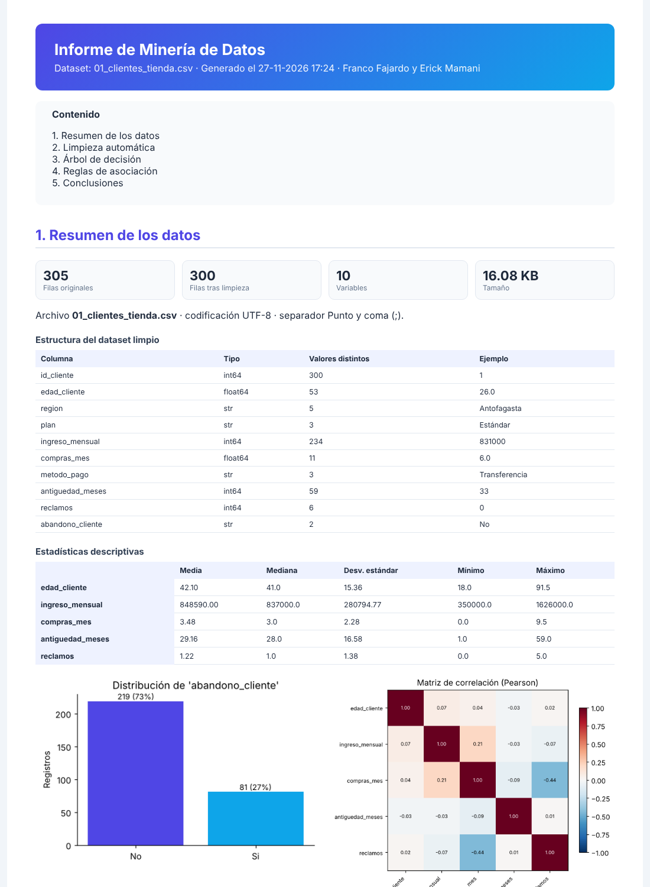

### RF6: Dashboard (parte del 25% de Informes y dashboard)
- [x] Distribuciones, correlaciones, resultados de modelos y filtros dinámicos — *QA-RF6-01 a QA-RF6-04*
- [ ] Capturas con filtros aplicados y de correlaciones

### Funcionamiento integrado (20% de la Nota 2)
- [ ] Flujo completo Carga → Limpieza → Árbol → Asociación → Dashboard → Informe sin errores, con al menos 2 datasets distintos.
- [ ] Al cargar otro dataset se reinician los resultados del anterior.

### Git y calidad del código (10% de la Nota 2)
- [x] Estructura por capas: `analisis/` (procesamiento), `web/` (presentación, una vista por pestaña), `datos/`, `storage/`, `tests/`, `docs/`.
- [x] Rutas y constantes centralizadas en `analisis/config.py`.
- [x] Pruebas automáticas en `tests/`.
- [ ] Ramas `main`, `develop` y `feature/...` con commits de ambos integrantes.
